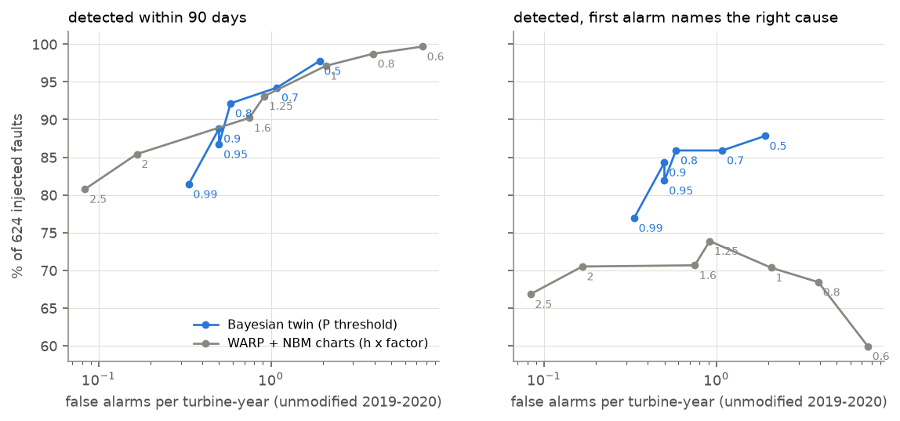
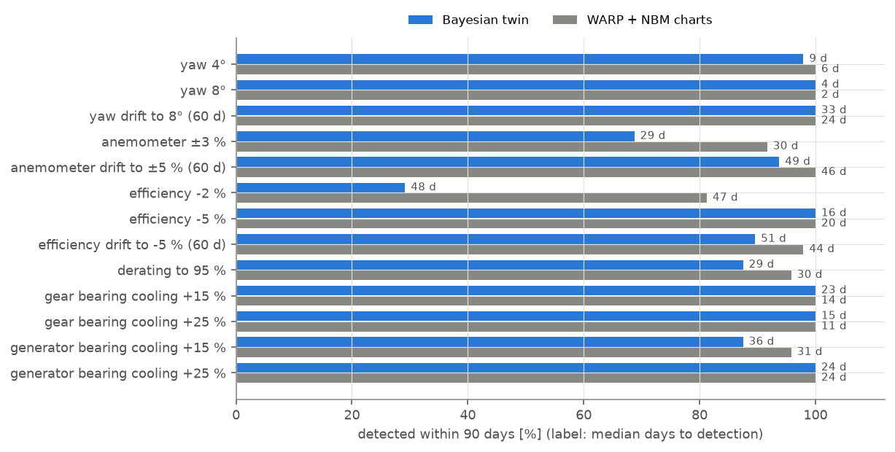
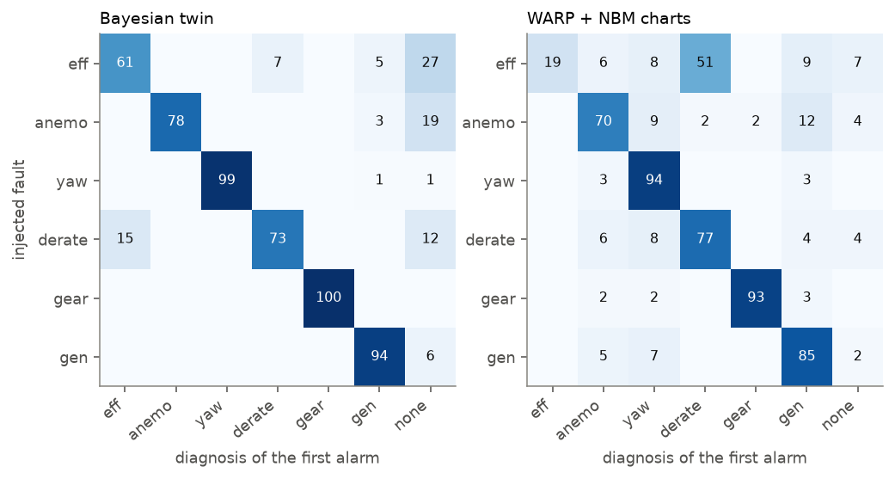
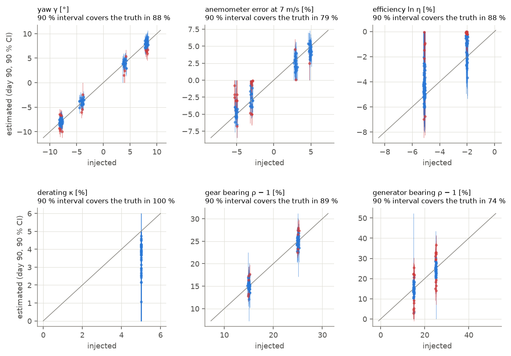
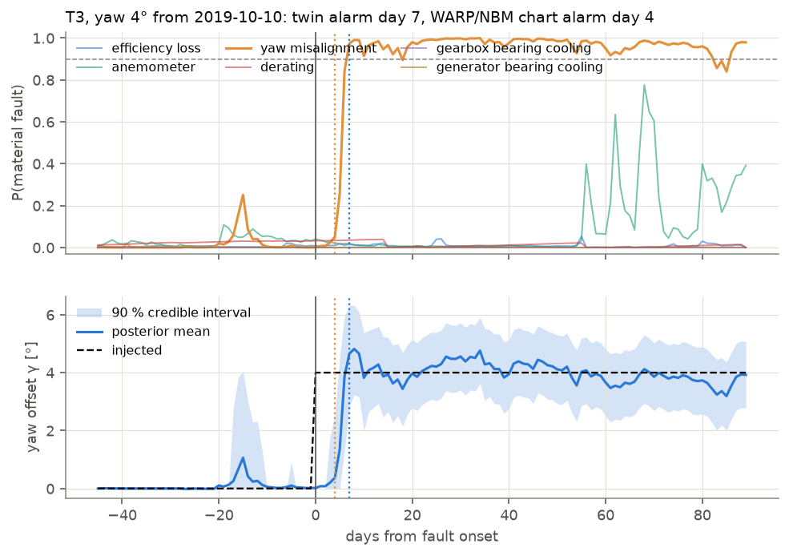
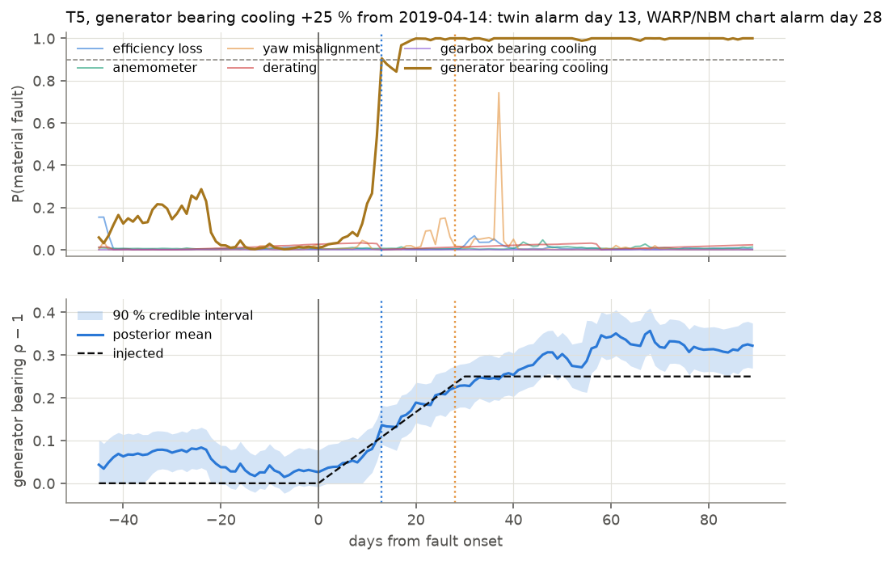
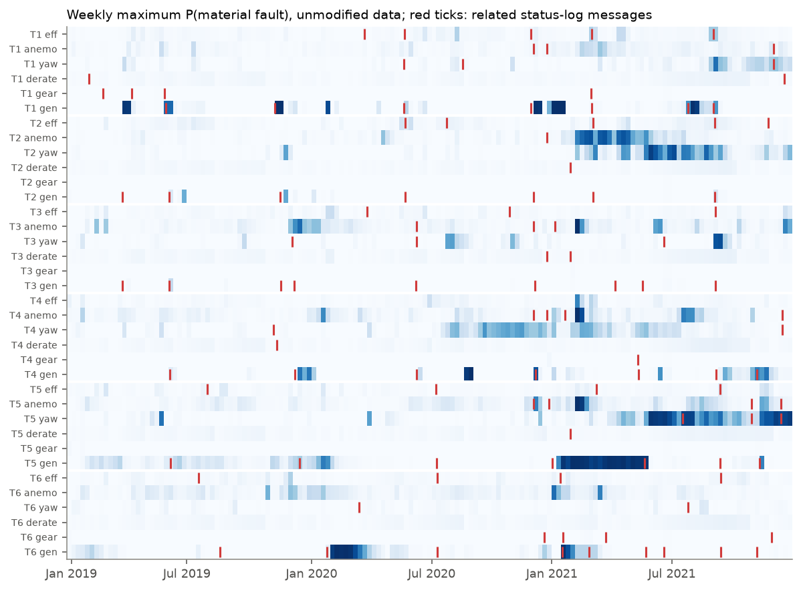
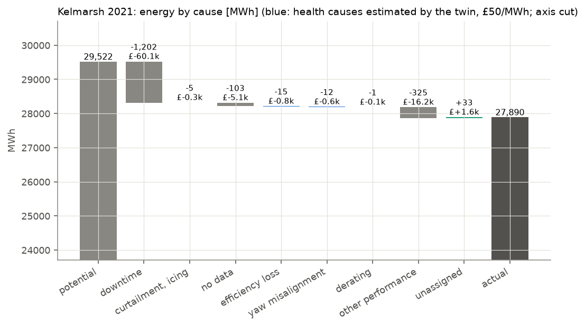

# A Bayesian digital twin of a wind farm

[](https://github.com/kwwaleszczynski-del/wind-bayes-twin/actions/workflows/ci.yml)

A probabilistic model of every turbine of a wind farm that is updated day by day from SCADA data. It keeps a posterior
distribution over hidden health parameters of each turbine - efficiency, nacelle anemometer error, static yaw offset,
power derating, thermal resistance of the gearbox and generator bearings - and turns it into the probability of each
fault type, the date a fault most likely started, the energy each cause has cost, and a ranking of inspections by
their expected value.

It combines the earlier single-purpose diagnostics of this portfolio into one model with uncertainty and cause
attribution: the wake-aware free-stream reference of
[wind-wake-aware-verification](https://github.com/kwwaleszczynski-del/wind-wake-aware-verification) (WARP), the
thermal RC models of [wind-thermal-nbm](https://github.com/kwwaleszczynski-del/wind-thermal-nbm) and the data cleaning
of [wind-power-curve-kelmarsh](https://github.com/kwwaleszczynski-del/wind-power-curve-kelmarsh). Those projects
detect each fault on its own chart; here one posterior weighs all the evidence against all the causes.

Everything runs on open data: six years of 10-minute SCADA from the **Kelmarsh wind farm** (UK, 6 x Senvion MM92, CC
BY 4.0), on a laptop CPU.

**Interactive dashboard:** posterior trajectories, fault probabilities, losses by cause, inspection ranking and
replays of injected faults -
[kwwaleszczynski-del.github.io/wind-bayes-twin](https://kwwaleszczynski-del.github.io/wind-bayes-twin/).

## Key results

Validation: 624 known faults injected into real 2019-2020 SCADA (13 scenarios x 6 turbines x 8 start dates), model
built on 2017 and calibrated on 2018, so nothing was tuned on the test years. The comparison runs the earlier
projects' detectors - the four WARP CUSUM charts and the two NBM thermal charts - on the same daily statistics and the
same injected faults.

| | Bayesian twin | WARP + NBM charts |
|---|---|---|
| injected faults detected within 90 days | 88.8 % | 97.1 % |
| median days to detection | 24 | 20.5 |
| **first alarm names the right cause** (of detected) | **95 %** | 72 % |
| **false alarms per turbine-year** (unmodified 2019-2020) | **0.50** | 2.08 |
| chance of an alarm in a 90-day window without a fault | 10 % | 40 % |
| fault size with a 90 % credible interval, onset date | yes | no |

- **At the same false-alarm rate the twin detects as much, and names the cause far more often.** Moving each system's
  alarm threshold traces its trade-off: at about one false alarm per turbine-year both detect 93-94 % of the faults,
  but the twin's first alarm names the right cause in 86 % of all faults against 74 % for the charts. The charts' weak
  point is the classic one - a power loss trips the full-load chart first and looks like a derating (51 % of
  efficiency losses are diagnosed as derating); the twin weighs the partial-load evidence against both explanations
  and waits until they part.



- **Fault sizes are recovered with honest uncertainty where the model is right.** Yaw offsets of 4° and 8° come back
  as 3.9° and 7.9° (90 % intervals about ±1.2°, covering the truth in 88-90 %); gearbox bearing cooling +15/+25 % as
  +15.2/+25.2 % (88-90 % coverage); a 5 % efficiency loss as 4.6 % (94 %). Coverage falls to 73-81 % for the
  anemometer and the generator bearing, whose real residuals wander more than the 2018 noise model knows.
- **The onset of a step fault is dated to the day** (median error 0-2 days for yaw, efficiency and cooling steps); for
  slow drifts the twin dates the moment the drift became visible, 12-17 days after it began.
- **Small power losses are the price of few false alarms.** A 2 % efficiency loss is found in 29 % of the cases
  (charts: 81 %, but with the right cause in 28 % of those): it is as large as the weeks-long wander of the reference
  at full load, which the noise model learned from 2018 and does not mistake for a fault.
- **On unmodified data the twin reproduces what the earlier projects found by separate means**, now with numbers
  attached: T5's nacelle runs 3.6° (2.2-4.9°) off its neighbours by the end of 2021, flagged from June (WARP: -2.8°;
  "Check vane!" logged in July, vane faults in November-December); T5's generator bearing had a 16-18 % larger
  temperature rise above its cooling air from mid-December 2020 to May 2021 (generator fan overloads logged on
  5 January 2021; wind-thermal-nbm saw the same bearing's rise grow); and in the cold spell of February 2021, a week
  after icing stops were logged, three nacelle anemometers read 5-7 % low for a few days - iced cups turn slowly.
- **Health losses are small at Kelmarsh, and the decision model says so.** In 2021 the twin attributes 15 MWh to
  efficiency loss, 12 MWh to yaw and 1 MWh to derating (about £1.4k at £50/MWh) against 1.2 GWh of downtime. Its top
  inspection on 31 December 2021 is T5's yaw (P = 0.95, £2.6/day), which under the stated costs does not pay within
  half a year. In the replays of injected faults the same rule recommends inspecting an efficiency drift (+£2.5k) and
  a 25 % generator cooling loss (+£1.3k).
- **Two independent inference engines agree.** The same validation run with a joint particle filter (no block
  factorisation, change-point-guided proposals) detects 90 % with the right cause in 93 % and 0.42 false alarms per
  turbine-year - within a few points of the run-length engine on every scenario.
- **Runs on a laptop CPU**: the whole pipeline in about half an hour; one turbine-day of filtering takes about 20 ms
  (40-80 ms with credible intervals and loss attribution).



## The model

Notation: turbine $`i`$ (dropped where clear), day $`d`$, 10-minute record $`t`$. The twin observes seven **daily
statistics** of each turbine, each a residual against a reference built from the *other* turbines, so a fault on $`i`$
cannot leak into its own reference:

| Statistic | Daily value | Records | Sees |
|---|---|---|---|
| `pow` | $`\ln(\sum P_t / \sum \hat P_t)`$ | normal operation, $`100\ \mathrm{kW} \le \hat P_t < 97\,\%`$ of rated | efficiency, yaw, (derating) |
| `full` | $`\ln(\sum P_t / \sum \hat P_t)`$ | normal operation, expected wind $`\hat e_t \ge 13`$ m/s (curve flat) | efficiency, derating |
| `alo`, `ahi` | $`\mathrm{median}\,\ln(u_t / \hat u_t)`$ | $`\hat u_t`$ in 4-7 and 7-11 m/s | anemometer scale and offset |
| `yaw` | $`\mathrm{median}\,\Delta_t`$ | free stream $`\ge`$ 4 m/s | static yaw offset |
| `tgear`, `tgen` | mean fleet-referenced RC residual [K] | producing | bearing thermal resistance |

**Reference (WARP).** $`\hat P_t = F(\hat e_t)`$ is the farm power curve at the turbine's expected power-equivalent
wind speed $`\hat e_t = E_{-i,t}\,(1 - d_{i,t})\,s_i(\theta, E, TI)`$: the free stream from the unwaked neighbours
(their power through the inverse power curve), the PyWake wake deficit at turbine $`i`$ and a smooth site factor
fitted on the baseline year. $`\hat u_t`$ is the anemometer reading expected from the neighbours' *power* alone and
$`\Delta_t`$ the turbine's nacelle position minus the neighbours' wind direction. The thermal statistics are the
first-order RC models of wind-thermal-nbm (gearbox rear bearing cooled by the gear oil, generator rear bearing by the
nacelle air), minus the median residual of the other producing turbines.

The full-load statistic `full` differs from WARP's (all records with $`\hat P_t \ge 97\,\%`$): it keeps only records
whose expected wind is well above rated, where a healthy turbine produces rated power whatever the exact wind. In the
calibration year that halves its day-to-day spread (0.4-1.1 % instead of 0.8-2.2 %) and most of its skew, at the cost
of half the days - about twice the information on a full-load fault.

**Hidden health state.** Per turbine and day, relative to its own healthy behaviour:

| Parameter | Meaning | Fault type | Material when |
|---|---|---|---|
| $`\ln\eta`$ | multiplicative power loss (blades, pitch, soiling) | efficiency | $`\ln\eta < -1\,\%`$ |
| $`\ln a,\ b`$ | anemometer scale and offset against the free stream | anemometer | $`\lvert \ln a + b/7 \rvert > 1.5\,\%`$ |
| $`\gamma`$ | static yaw offset against the neighbours' wind direction | yaw | $`\lvert\gamma\rvert > 2.5°`$ |
| $`\kappa`$ | power limited to $`(1-\kappa)`$ of rated | derating | $`\kappa > 2\,\%`$ |
| $`\rho_g - 1`$ | thermal resistance of the gearbox bearing to its oil, relative | gear cooling | $`> 10\,\%`$ |
| $`\rho_n - 1`$ | thermal resistance of the generator bearing to the nacelle air, relative | generator cooling | $`> 10\,\%`$ |

The materiality thresholds say what is worth acting on; they are set before any validation and are part of the model,
not tuned. **P(fault k)** is the posterior probability that fault type $`k`$ is present *and* material.

**Dynamics: spike and slab with switching.** Each fault type is off (its parameters are exactly zero, the spike) or
on. It switches on with hazard $`\lambda_k = 10^{-3}`$ per day; at onset its parameters are drawn from a slab, then
follow a random walk, so a fault can be a step, a drift or both; it switches off (repair, a transient fault ending)
with hazard $`h_r = 1/200`$ per day:

```math
\theta_{k,d} = 0 \ \ (\text{off}), \qquad
\theta_{k,d_0} \sim \mathcal{N}(m_k, S_k^2) \ \ (\text{onset}), \qquad
\theta_{k,d} = \theta_{k,d-1} + w_{k,d},\ \ w_{k,d} \sim \mathcal{N}(0, q_k^2) \ \ (\text{on})
```

Slab widths $`S_k`$: 5 % for efficiency (centred on a 2.5 % loss), 4 % and 0.3 m/s for the anemometer, 6° for yaw,
30 % for the thermal resistances; derating is a half-normal of width 10 % of rated on a grid of 15 values from 1 to
40 %. Daily random-walk steps $`q_k`$: 0.2 % (efficiency), 0.1 % and 0.01 m/s (anemometer), 0.2° (yaw), 1 % (cooling).

**Observation model.** Every statistic is a known function of the health state plus a healthy level, a slow AR(1)
wander of the reference error and day-to-day noise:

```math
y_{s,d} = h_s(\theta_d) + \mu_{s,d} + n_{s,d} + \varepsilon_{s,d}, \qquad
\mu_{s,d} = \mu_{s,d-1} + \nu_{s,d}, \qquad n_{s,d} = \phi_s\, n_{s,d-1} + w_{s,d}
```

```math
h_\mathrm{pow}(\theta) = \ln \frac{\sum_t \mathrm{E}_r\big[\min\big(r\,\eta\,F(\hat e_t \cos^{n/3}\gamma),\ (1-\kappa)P_r\big)\big]}{\sum_t F(\hat e_t)},
\qquad h_\mathrm{alo} = \ln\big(a + b/\tilde u_\mathrm{lo}\big), \qquad h_\mathrm{yaw} = \gamma, \qquad
h_\mathrm{tgear} = (\rho_g - 1)\,\tilde R_d
```

The power statistics are evaluated **record by record**: a power cap or a yaw offset acts on each 10-minute value, not
on the daily sum. $`r`$ is the turbine's own healthy record-to-record ratio $`P_t/\hat P_t`$ at full load (20
quantiles, calibration year): a cap only removes the part of the scatter above it. The yaw loss is the cos^n law of
WARP's fault model applied as an effective wind speed ($`n = 2`$), so a misaligned turbine still reaches rated power.
$`\tilde u`$ is the day's median expected anemometer reading in the band, $`\tilde R_d`$ the day's mean temperature
rise of the RC model above the cooling side.

The noise is robust: each daily value is an outlier with probability 2 % (a component 10 times wider: icing, a service
visit, a logging glitch), and its variance falls with the number of records behind it,
$`\mathrm{Var}\,\varepsilon_{s,d} = \sigma_{e,s}^2\, c_\mathrm{ref}/c_{s,d}`$.

**Healthy behaviour: a hierarchical model (offline).** $`\mu_s`$, $`\sigma_{e,s}`$, $`\sigma_{w,s}`$ and $`\phi_s`$ of
every turbine are learned on the calibration year with partial pooling between the six turbines (NumPyro, NUTS):

```math
\mu_i = \mu_0 + \tau z_i, \qquad \ln\sigma_{e,i} = a_e + b_e z^e_i, \qquad \ln\sigma_{w,i} = a_w + b_w z^w_i, \qquad
\mathrm{logit}\,\phi_i = a_\phi + b_\phi z^\phi_i, \qquad z \sim \mathcal{N}(0, 1)
```

The AR(1) states are integrated out by a Kalman filter inside the likelihood (`jax.lax.scan`; exact for the Gaussian
part, the outlier mixture is moment-matched after each day exactly as in the online filter), so NUTS samples only the
24 turbine parameters and 8 hyperparameters of each statistic. One year and six turbines are few: pooling keeps a
turbine with an unusual year from getting an implausible noise model, while $`\tau`$ lets turbines differ where the
data say so (the yaw levels do, the full-load levels hardly). The slow drift of the healthy level $`\nu`$ is set from
the change of every turbine's median between the baseline and the calibration year.

## Inference

### Online: change-point recursion with Kalman segments (primary engine)

The model splits into five blocks that share no statistic: **power** (`pow`, `full`: efficiency, derating), **yaw**,
**anemometer** (`alo`, `ahi`), **gearbox bearing** and **generator bearing**. Within a block, once the fault type, its
onset day and (for derating) the cap are fixed, everything else is linear and Gaussian: the fault parameter, the
healthy levels and the AR(1) wander of the block's statistics form one Kalman state. So the posterior is a mixture
over **hypotheses** - "healthy", or "fault type $`k`$ since $`r`$ days" (Adams & MacKay's run length) - each with an
exact Kalman mean, covariance and predictive likelihood:

```math
p(h_d \mid y_{1:d}) \ \propto\ \mathcal{N}\big(y_d;\ \hat y_d^{(h)},\ S_d^{(h)}\big) \sum_{h'} p(h_d \mid h_{d-1}=h')\, p(h' \mid y_{1:d-1})
```

The transitions are the spike-and-slab dynamics above: from any hypothesis a new segment of type $`k`$ starts with
rate $`\lambda_k`$, a fault segment ends with rate $`h_r`$. All healthy histories have the same future and are merged
every day; a new segment starts from the moment-matched mixture of the nuisance states of all hypotheses; run lengths
beyond 120 days (30 for the derating grid) are merged by moment matching; hypotheses below $`10^{-8}`$ are dropped.
This is the exact recursion of Fearnhead & Liu (2007) up to these mergers, with Kalman segment models in the spirit of
Chen & Liu's mixture Kalman filter (2000). It has no Monte Carlo error: evidence that accumulates over weeks is never
lost by resampling, it is deterministic, and it dates the onset of a fault (the run-length posterior).

The yaw block runs first; its posterior mean $`\hat\gamma`$ enters the power block's yaw loss as a known input
(plug-in coupling). This and the merging are the only approximations.

### Online: joint particle filter (cross-check)

The same model without the block factorisation: a Rao-Blackwellised particle filter (Doucet et al. 2000) whose
particles carry all seven parameters and six on/off states, while the healthy levels and AR(1) wander are integrated
out by a Kalman filter per particle (their covariance depends only on which days were observed, so it is shared). Rare
jumps are the weak point of a bootstrap particle filter: few particles try an onset of the right size at the right
time. A **Bayesian online change-point detector** (Adams & MacKay 2007) on every statistic therefore *guides* the
proposal: when it reports a recent change, more particles try an onset of the type that statistic sees, half of them
with a size centred on the new segment's level. The weights are corrected exactly,

```math
w_d^{(j)} \propto w_{d-1}^{(j)}\ \frac{p\big(x_d^{(j)} \mid x_{d-1}^{(j)}\big)}{q\big(x_d^{(j)} \mid x_{d-1}^{(j)}, \mathrm{CP}_d\big)}\
\prod_s \mathcal{N}\big(y_{s,d};\ \hat y_s^{(j)},\ S_{s,d}\big),
```

so the detector changes where the particles are, not the posterior. 2000 particles, systematic resampling below an
effective sample size of 1000.

### Why these choices

- **A switching state-space model rather than a classifier**: faults are rare and few are labelled; the model is built
  from physics that the earlier projects validated (wakes, power curves, RC thermal models), and its parameters have
  units an engineer can check (degrees of yaw, percent of power, kelvin).
- **Daily statistics, record-level physics.** 10-minute residuals are strongly correlated (weather passing over the
  farm); treating 144 records a day as independent would make every posterior far too confident. The noise is modelled
  where it is honest (per day, with a calibrated AR(1) wander), while the nonlinear effects (power cap, yaw loss) are
  still applied record by record.
- **Exact run-length recursion as the main engine** because the problem is mostly "when did something change, and
  what": the run length is discrete and small, the rest is linear-Gaussian given it. The particle filter is kept as an
  independent check of the factorisation and as the general tool if the model became more nonlinear.
- **Hierarchical priors** because one healthy year per turbine is too little to set seven noise models independently,
  and too much to ignore that turbines differ.
- **Everything on a laptop CPU**: see [Computational cost](#computational-cost).

## Outputs

- **Posterior trajectories** of every parameter with 90 % credible intervals, and **P(fault k)** per type.
- **Alarm**: types that explain the same statistics compete (an efficiency loss and a derating both lower full-load
  power, and for weeks the data may not tell which), so an alarm is raised when the probability that a block has a
  material fault exceeds 0.9 (re-armed below 0.5); the diagnosis is the block's most probable type.
- **Onset date**: the posterior mode of the run length of the active fault type.
- **Lost energy by cause.** The energy lost against a healthy turbine,
  $`L(\theta) = \sum_t \big[F(\hat e_t) - P_t(\theta)\big]\Delta t`$, is split between efficiency, yaw and derating by
  the Shapley value (the causes interact: a cap hides part of an efficiency loss), averaged over 200 posterior draws
  per day:
  $`\varphi_k = \sum_{S \subseteq C\setminus\{k\}} \frac{|S|!\,(|C|-|S|-1)!}{|C|!}\,\big[L(S\cup\{k\}) - L(S)\big]`$.
- **Inspection ranking (value of information, simplified).** For turbine $`i`$ and fault type $`k`$: an inspection
  costs $`C_\mathrm{insp}`$ and reveals the truth; a fault found is fixed at $`C_{\mathrm{fix},k}`$, which removes its
  cost for the rest of the horizon $`H`$ (180 days: until it would be found anyway at the next service). With $`V_k`$
  = posterior cost rate x $`H`$:

```math
\text{value of inspecting} = \mathrm{E}\big[\max(V_k - C_{\mathrm{fix},k},\ 0)\big] - C_\mathrm{insp}, \qquad
\mathrm{EVPI} = \mathrm{E}\big[\max(V_k - C_{\mathrm{fix},k},\ 0)\big] - \max\big(\mathrm{E}[V_k] - C_{\mathrm{fix},k},\ 0\big)
```

  The ranking is by the value of inspecting (a draw better than healthy costs nothing); EVPI is the part of it that
  comes from resolving uncertainty rather than from an already certain fault. All economic inputs are assumptions,
  stated in one place (`attribution.Economics`):

| Input | Value |
|---|---|
| energy price | £50/MWh |
| horizon | 180 days (to the next scheduled service) |
| inspection | £500 |
| repair: efficiency (pitch/blade) / yaw (vane) recalibration / anemometer / derating reset / gear cooling / generator cooling | £4000 / £600 / £800 / £200 / £3000 / £2000 |
| cost of a bearing cooling fault (illustrative) | +10 percentage points annual failure probability per +25 % thermal resistance x £150k (gearbox) / £60k (generator) |
| cost of an anemometer fault (illustrative) | £5/day (degraded control and reporting; no direct energy loss in the model) |

## Validation with injected faults

### Protocol

The same protocol as the earlier projects, so nothing is tuned on the test years:

| Period | Used for |
|---|---|
| 2017 (baseline) | farm power curve, nacelle offsets, site factors of the reference, RC thermal models |
| 2018 (calibration) | hierarchical noise model, record dispersion at full load, thresholds of the WARP and NBM charts; assumed fault-free |
| 2019-2020 (test) | false alarms on unmodified data; fault injection |
| 2021 (application) | unmodified data against the turbines' status logs |

Every turbine is filtered from 1 January 2019 on unmodified data. For each of 13 fault scenarios, six turbines and
eight start dates spread over 2019-2020, the fault is injected into that turbine's real records for 90 days (signs
alternate between start dates for yaw and anemometer faults) and the twin restarts from its clean state on the start
day: 624 runs. Only the faulty turbine's own signals change; its references come from the other turbines.

| Scenario | What changes in the faulty turbine's records | Truth for the twin |
|---|---|---|
| yaw 4°, 8° (step) and drift to 8° in 60 days | nacelle position moves by δ; power follows a cos² law of vane + δ as an effective wind speed (WARP's fault) | $`\gamma = -\delta`$ |
| anemometer ±3 % (step), drift to ±5 % in 60 days | both anemometers x (1 + b); power unchanged | $`\ln(1 + b)`$ at 7 m/s |
| efficiency -2 %, -5 % (step), drift to -5 % in 60 days | power x (1 - s) at all wind speeds | $`\ln\eta = \ln(1 - s)`$ |
| derating to 95 % | power capped at 95 % of rated | $`\kappa = 0.05`$ |
| gear / generator bearing cooling +15 %, +25 % (30-day ramp) | bearing temperature + (ρ - 1) x (temperature - cooling side) | $`\rho - 1`$ |

The comparison runs the WARP charts (power, full load, anemometer, yaw) and the NBM charts ("RC + fleet", trailing
baseline, gearbox and generator bearing) on **the same daily statistics** and the same injected faults, with the
thresholds of the earlier projects set on 2018. A system detects a fault when it alarms within 90 days; its diagnosis
is the type its first alarm points to (the twin's most probable type, a chart's target). The chance level is the same
count on the unmodified data in the same windows.

### Detection, delay and diagnosis

Detection rate within 90 days, median days to detection and the share of detected faults whose first alarm names the
injected cause:

| Injected fault | Twin: detected (median days) | right cause | WARP + NBM: detected (median days) | right cause |
|---|---|---|---|---|
| yaw 4° | 98 % (9 d) | 100 % | 100 % (6 d) | 96 % |
| yaw 8° | 100 % (4 d) | 100 % | 100 % (2 d) | 98 % |
| yaw drift to 8° (60 d) | 100 % (33 d) | 98 % | 100 % (24 d) | 90 % |
| anemometer ±3 % | 69 % (29 d) | 97 % | 92 % (30 d) | 75 % |
| anemometer drift to ±5 % (60 d) | 94 % (49 d) | 96 % | 100 % (46 d) | 71 % |
| efficiency -2 % | 29 % (48 d) | 64 % | 81 % (47 d) | 28 % |
| efficiency -5 % | 100 % (16 d) | 88 % | 100 % (20 d) | 19 % |
| efficiency drift to -5 % (60 d) | 90 % (51 d) | 86 % | 98 % (44 d) | 17 % |
| derating to 95 % | 88 % (29 d) | 83 % | 96 % (30 d) | 80 % |
| gear bearing cooling +15 % | 100 % (23 d) | 100 % | 100 % (14 d) | 92 % |
| gear bearing cooling +25 % | 100 % (15 d) | 100 % | 100 % (11 d) | 94 % |
| generator bearing cooling +15 % | 88 % (36 d) | 100 % | 96 % (31 d) | 85 % |
| generator bearing cooling +25 % | 100 % (24 d) | 100 % | 100 % (24 d) | 90 % |
| **all 624** | **88.8 % (24 d)** | **95 %** | **97.1 % (20.5 d)** | **72 %** |
| *chance (same windows, no fault)* | *10 %* | | *40 %* | |
| *false alarms per turbine-year* | *0.50* | | *2.08 (WARP 1.08, NBM 1.00)* | |

The charts' higher raw detection comes with four times the false alarms: 40 % of 90-day windows contain a chart alarm
even without a fault, so a good part of their "detections" of small faults are alarms that would have come anyway. All
six false alarms of the twin in 2019-2020 are on the generator bearing, whose fleet-referenced residual has the
largest weeks-long wander (episodes of fan and heater overloads in the status log); the other five fault types raised
none.



*Share of injected faults (rows) by the diagnosis of the first alarm (columns); "none": not detected in 90 days.*

The charts misread an efficiency loss as a derating half of the time because the full-load chart is the most sensitive
to both. The twin keeps both hypotheses (they share the power block and compete for the same full-load evidence),
raises the alarm on their sum and names the one the partial-load data favour; when it errs, it errs in the same pair
(7 % of efficiency losses called derating, 15 % of deratings called efficiency).

### Parameter recovery and coverage

Posterior on the last day of the 90-day window against the injected value:

| Injected fault | truth | median estimate | 90 % interval covers the truth | median interval width |
|---|---|---|---|---|
| yaw 4° / 8° | 4° / 8° | 3.9° / 7.9° | 88 % / 90 % | 2.4° |
| yaw drift to 8° | 8° | 7.7° | 85 % | 2.4° |
| anemometer ±3 % / drift to ±5 % | 3.0 % / 4.9 % | 2.6 % / 4.4 % | 77 % / 81 % | 3.3-3.5 % |
| efficiency -2 % / -5 % / drift to -5 % | 2.0 % / 5.1 % / 5.1 % | 0.6 % / 4.6 % / 4.3 % | 77 % / 94 % / 92 % | 2.7-5.8 % |
| derating to 95 % | 5 % | 3.9 % | 100 % | 5 % |
| gear bearing cooling +15 % / +25 % | 15 % / 25 % | 15.2 % / 25.2 % | 90 % / 88 % | 3.5 % |
| generator bearing cooling +15 % / +25 % | 15 % / 25 % | 14.6 % / 24.6 % | 75 % / 73 % | 10.5 % |

On data simulated from the model itself the 90 % intervals cover the truth in 94 % of 400 replications (gearbox
bearing block; slightly conservative, checked in the tests). On real data they are close to nominal for yaw,
efficiency and the gearbox bearing, and too narrow for the anemometer and the generator bearing: there the residual
wanders more than the AR(1) model learned on one year allows, and the injected faults are not exactly the model's (a
vane-driven cos² law, a cooling loss proportional to the measured rather than the modelled temperature rise). Biases
are small for yaw (at most 0.3°), the anemometer and the bearings (at most 0.5 percentage points); efficiency drifts
and the derating are underestimated by about 1 point (the posterior still weighs "no fault" and the competing type),
and the 2 % efficiency loss has not been accepted at all after 90 days in 7 of 10 cases.



### Two replays



*A 4° yaw offset on T3 from 10 October 2019. The posterior moves to the new value within a week, the 90 % interval
covers 4° from then on; the false start at day -16 (a one-week excursion of the nacelle direction in the real data) is
absorbed without an alarm.*



*A 25 % loss of generator bearing cooling on T5 from 14 April 2019, ramped over 30 days: the twin follows the ramp and
alarms on day 13, when the change becomes material (the NBM chart on day 28); on day 90 the decision rule recommends
an inspection (expected net value £1.3k).*

## Unmodified data, 2019-2021



*Weekly maximum of P(material fault) for every turbine and fault type; red ticks: related status-log messages.*

**Logged events.** The status logs of 2019-2021 hold 111 episodes related to the twin's fault types (messages of the
same group on the same turbine within 14 days merged): 46 generator cooling (fan and heater overloads), 21 pitch and
limit-switch, 15 anemometer (icing, 4-20 mA faults, defects), 13 vane and yaw, 9 gearbox oil and bearing, 7 power
reduction. An episode counts as anticipated if the system alarmed on the matching type in the 60 days before it:

| System | anticipated (of 111) | expected by chance | alarm from 7 days before to 30 days after |
|---|---|---|---|
| Bayesian twin | 4 | 5.3 | 9 |
| WARP charts | 8 | 8.9 | 11 |
| NBM charts | 7 | 10.4 | 10 |

None of the systems anticipates the logged events better than chance - the same finding as in wind-thermal-nbm: the
logged messages are acute states (an overloaded fan, an iced cup, a vane signal fault), not the end of a slow
degradation. The twin's alarms *around* the events are mostly generator bearing episodes that coincide with fan and
heater overloads (6 of 46), and T5's yaw alarms around the vane messages of July and November-December 2021.

**Case studies.**

- **T5, yaw, 2021.** From April the nacelle direction drifts away from the neighbours'; P(yaw) passes 0.9 on 3 June
  and the posterior ends the year at -3.6° (90 %: -4.9 to -2.2°). The log reports "Check vane!" on 21 July and vane
  1/2 signal faults and a "Vane 2 defect" in November-December. WARP measured -2.8° for the year and showed with its
  cos² fit that the power optimum moved with the nacelle, i.e. most of it is a nacelle-position offset: the
  identifiability limit described below. The WARP yaw chart raised 19 alarms on T5 in 2021 (one per CUSUM restart);
  the twin raised 3 and kept one estimate with an interval.
- **T5, generator bearing, winter 2020-21.** The temperature rise of the rear generator bearing above the nacelle air
  was 16-18 % (90 %: 11-23 %) larger than in 2018 from mid-December 2020 to the end of May 2021, then returned to
  normal; the generator fans overloaded on 5 January 2021. In wind-thermal-nbm the fitted rise of this bearing grew
  from 11.8 to 20.3 K between 2017 and 2021.
- **Icing, February 2021.** A week after icing stops on T2, T3 and T5 (1 February), the anemometers of T3, T4 and T5
  read 5-7 % low against the neighbours' power for four to six days (9-15 February) and the twin flagged them as
  anemometer faults. On T4, whose power also dropped, the posterior weighed an efficiency loss as well (up to 0.68, no
  alarm) - the twin keeps the instrument and the turbine apart.
- **T1, generator bearing.** T1's generator bearing has short warm episodes several times a year; three of its five
  alarms in 2019-2021 came within one to two weeks after logged generator fan or heater overloads (November 2019,
  December 2020, July-August 2021). They count as false alarms in the validation, which is conservative.

**Lost energy by cause.** Over 2019-2021 the twin attributes 27, 16 and 3 MWh to efficiency loss, yaw and derating
(about £2.3k at £50/MWh); the turbines' downtime cost 2.1 GWh. The rest of the performance gap (about 1 % of the
potential every year) is the turbines' healthy offset from a reference fitted on 2017, not a fault.



**Inspection ranking.** At every quarter end the twin values an inspection of each fault type on each turbine
(dashboard). On unmodified data no inspection pays under the stated costs: the top item on 31 December 2021 is T5's
yaw (P = 0.95, £2.6/day; an inspection and recalibration for £1,100 would pay after about 14 months, not within the
180-day horizon), followed by small anemometer and derating hypotheses whose value is almost all information (EVPI).
The same rule does recommend an inspection in the replays of injected faults with a material cost: a 5 % efficiency
drift on T1 (+£2.5k on day 90) and a 25 % generator cooling loss on T5 (+£1.3k), but not a 4° yaw offset (-£430).

## Two engines, one model

The whole validation was run with both inference engines on the same model, noise model and injected faults:

| | Run-length + Kalman (primary) | Joint particle filter, guided | Joint particle filter, unguided |
|---|---|---|---|
| detected within 90 days | 88.8 % | 90.2 % | 90.4 % |
| median days to detection | 24 | 24 | 25 |
| first alarm names the right cause | 95 % | 93 % | 92 % |
| false alarms per turbine-year | 0.50 | 0.42 | 0.25 |
| efficiency -2 % / derating 5 % detected | 29 % / 88 % | 38 % / 92 % | 40 % / 92 % |
| 90 % interval coverage: yaw / gearbox / generator | 88-90 % / 88-90 % / 73-75 % | 85-90 % / 88 % / 71-73 % | 85-92 % / 85-88 % / 67-69 % |
| seconds per 90-day injection run (median) | 1.5 | 2.6 | 2.6 |

The two engines agree to within a few points on every scenario, which checks the factorisation into blocks and the
plug-in coupling of yaw and power: an approximation that mattered would show up as a gap. The particle filter is
slightly more sensitive to power-curve faults - it can hold an efficiency loss and a derating at the same time and
needs no plug-in - and slightly worse on the generator bearing, where Monte Carlo error adds to a noisy residual.

Without the change-point guidance (bootstrap proposals only) the particle filter targets the same posterior and
detects as many faults, but later after a step and with less precise sizes right after it: a 4° yaw offset is flagged
after 14 days instead of 8 (an 8° one after 6 instead of 4), a derating is named correctly in 66 % instead of 77 % of
the cases, and the intervals of a 3 % anemometer step cover the truth in 60 % instead of 75 % - few particles sit near
the new value when the jump happens. It raises fewer false alarms (0.25 per turbine-year), because the guidance also
follows changes that turn out to be wander. The detector buys Monte Carlo efficiency where a bootstrap filter is
weakest, just after a jump, without changing what the filter estimates.

## Computational cost

Laptop: Intel i7-10850H (6 cores), 64 GB RAM, Windows, Python 3.13; the campaigns shared the CPU with another job.

| Step | Time |
|---|---|
| read five yearly archives (1.6 million 10-minute turbine records) into Parquet | 83 s |
| `prepare`: wake tables (PyWake), reference fit and prediction, RC fits, daily statistics | 3 min |
| `calibrate`: NUTS for 7 statistics x 2 chains x 1200 iterations (Kalman likelihood in `lax.scan`) | 11-19 min |
| run-length engine: one turbine-day, five blocks, ~1,000-2,000 hypotheses | ~20 ms |
| ... with daily credible intervals and Shapley loss attribution | 40-80 ms |
| joint particle filter, 2000 particles: one turbine-day | ~40 ms |
| `validate`: 6 clean runs 2019-2021 + 624 injection runs, 6 processes | 9-12 min per engine |
| `cases` (logs, quarterly decisions) and `report` | 2 min |

Memory is about 0.5 GB per process (the prepared 10-minute data of five years). Everything after `prepare` reads only
the daily statistics and the records behind the power statistics, so the online part would run on a farm's SCADA
server in real time with room to spare.

## Limitations

- **Identifiability.** Some causes look alike in the statistics the twin sees, and the posterior says so instead of
  guessing:
  - *Efficiency loss vs derating*: both lower the power at full load; only the partial-load statistic, five times
    noisier, tells them apart. For weeks the posterior splits between the two - which is why alarms are raised per
    block and the diagnosis is the more probable type.
  - *Yaw misalignment vs a nacelle-position offset*: the yaw statistic measures where the nacelle points relative to
    the neighbours' wind direction. A rotor that really runs off the wind and a recalibrated north reference move it
    alike; the energy loss of a few degrees (cos² of 4° is 0.5 %) is far below the daily power noise. The twin calls
    both "yaw" and prices them as a real misalignment. WARP's cos² fit separates them with months of data.
  - *Anemometer scale vs offset*: told apart only by the two wind bands; the materiality is judged on the combined
    error at 7 m/s.
  - *Cooling vs sensor drift*: a thermal-resistance change scales with the temperature rise, a sensor drift does not;
    with one state per bearing, a drifting sensor is reported as a cooling change.
- **Sensitivity to priors.** The onset hazard (one fault per type per ~3 years), the slab widths and the materiality
  thresholds set how much evidence an alarm needs. They are stated, not fitted; the trade-off curves show what a
  different alarm threshold buys. The healthy levels and noise come from one calibration year: a year of unusual
  weather or an undetected fault in it shifts them.
- **Model error the noise model does not know.** The slow wander of the reference (weather regimes lasting weeks) is
  modelled as AR(1) with parameters from 2018; where it is larger than that, the twin raises false alarms (most of
  them on the generator bearing, whose residual wanders the most), where smaller, it is slower than needed.
- **Approximations of the engine.** Blocks are independent except for the yaw plug-in; at most one fault type is
  active per block at a time; run lengths beyond 120 days and the nuisance states at change points are merged by
  moment matching. The joint particle filter, which has none of these approximations, is the check.
- **Idealised injected faults**, the same as in the earlier projects (a cos² yaw law driven by the vane, a pure
  anemometer scale error, a hard power cap, a proportional cooling loss). Real faults come and go and mix.
- **One farm, six turbines, two test years.** 48 injections per scenario (about ±7 points on a detection rate); false
  alarms from 12 turbine-years.
- **No CARE to Compare score.** The benchmark's datasets are single turbines without neighbours, and the twin's
  references are built from the neighbours; its thermal part alone corresponds to the RC model already benchmarked in
  wind-thermal-nbm (CARE score 0.47).
- **Economics are illustrative.** Price, repair and inspection costs and the failure-risk model of a bearing are
  assumptions in one place (`attribution.Economics`); the ranking changes with them, the method does not.

## Run it

```bash
pip install -e ".[dev]"
pytest -q
export KELMARSH_DATA_DIR=/path/to/kelmarsh/data      # folder with raw/Kelmarsh_SCADA_<year>_*.zip (Zenodo 16807551)
python -m wind_bayes_twin prepare                     # archives -> reference, RC models, daily statistics (~2.5 min)
python -m wind_bayes_twin calibrate                   # hierarchical noise model, NUTS (~11 min)
python -m wind_bayes_twin validate --workers 6        # clean runs 2019-2021 + 624 injections
python -m wind_bayes_twin validate --engine particle  # the same with the joint particle filter
python -m wind_bayes_twin cases                       # status-log events, losses by cause, inspection ranking
python -m wind_bayes_twin report                      # figures in docs/img, dashboard docs/index.html
```

The SCADA archives (1.8 GB) are not part of the repository; download them from
[Zenodo](https://doi.org/10.5281/zenodo.16807551) into `data/raw` or point `KELMARSH_DATA_DIR` at an existing copy.
Intermediate results are cached in `data/processed`.

```
src/wind_bayes_twin/
  data.py          Kelmarsh archives: 10-minute signals and status logs, Parquet cache
  farm.py          (time x turbine) arrays, record classification (normal, stops, curtailment, icing, sensor)
  reference.py     free-stream reference from the neighbours: power curve, PyWake wakes, site factors (WARP)
  thermal.py       RC thermal models and the fleet-referenced residual
  stats.py         the seven daily statistics and the records behind the power ones
  model.py         health parameters, spike-and-slab dynamics, observation model, materiality
  hierarchy.py     offline hierarchical noise model (NumPyro, NUTS, Kalman likelihood)
  changepoint.py   online engine: run-length recursion with Kalman segment models, per block
  twin_filter.py   online engine: joint Rao-Blackwellised particle filter with change-point-guided proposals
  bocpd.py         Bayesian online change-point detection (Adams & MacKay 2007)
  attribution.py   lost energy by cause (Shapley), value-of-information inspection ranking
  faults.py        fault injection into real records
  baselines.py     WARP and NBM CUSUM charts on the same statistics
  validation.py    injection campaign, alarms, false alarms
  experiments.py   campaign summaries, logged events, decisions, energy balance
  pipeline.py, twin.py, report.py, cli.py, dashboard.html
tests/             pytest on data simulated from the model itself (no network, no Kelmarsh data)
```

## Data, licence and credits

Code: MIT. Data: *Kelmarsh wind farm data*, C. Plumley and R. Takeuchi, Cubico Sustainable Investments,
[doi:10.5281/zenodo.16807551](https://doi.org/10.5281/zenodo.16807551), CC BY 4.0; the raw data are not redistributed,
`results/` and `docs/` hold derived tables and figures only. Wake model:
[PyWake](https://gitlab.windenergy.dtu.dk/TOPFARM/PyWake) (DTU Wind Energy, MIT). Probabilistic programming:
[NumPyro](https://github.com/pyro-ppl/numpyro) on [JAX](https://github.com/jax-ml/jax) (Apache 2.0). The reference,
thermal model and cleaning re-implement, with changes, the methods of the earlier projects
[wind-wake-aware-verification](https://github.com/kwwaleszczynski-del/wind-wake-aware-verification),
[wind-thermal-nbm](https://github.com/kwwaleszczynski-del/wind-thermal-nbm) and
[wind-power-curve-kelmarsh](https://github.com/kwwaleszczynski-del/wind-power-curve-kelmarsh); this repository does
not depend on them.

## References

- R. P. Adams, D. J. C. MacKay (2007). *Bayesian online changepoint detection.* arXiv:0710.3742.
- P. Fearnhead, Z. Liu (2007). *On-line inference for multiple changepoint problems.* J. R. Stat. Soc. B 69(4),
  589-605.
- R. Chen, J. S. Liu (2000). *Mixture Kalman filters.* J. R. Stat. Soc. B 62(3), 493-508.
- A. Doucet, N. de Freitas, K. Murphy, S. Russell (2000). *Rao-Blackwellised particle filtering for dynamic Bayesian
  networks.* Proc. UAI 2000, 176-183.
- N. J. Gordon, D. J. Salmond, A. F. M. Smith (1993). *Novel approach to nonlinear/non-Gaussian Bayesian state
  estimation.* IEE Proc. F 140(2), 107-113.
- E. I. George, R. E. McCulloch (1993). *Variable selection via Gibbs sampling.* J. Am. Stat. Assoc. 88(423), 881-889
  (spike-and-slab priors).
- G. E. P. Box, G. C. Tiao (1968). *A Bayesian approach to some outlier problems.* Biometrika 55(1), 119-129.
- M. D. Hoffman, A. Gelman (2014). *The No-U-Turn sampler.* J. Mach. Learn. Res. 15, 1593-1623.
- D. Phan, N. Pradhan, M. Jankowiak (2019). *Composable effects for flexible and accelerated probabilistic programming
  in NumPyro.* arXiv:1912.11554.
- A. Gelman, J. B. Carlin, H. S. Stern, D. B. Dunson, A. Vehtari, D. B. Rubin (2013). *Bayesian Data Analysis*, 3rd
  ed., ch. 5 (hierarchical models).
- R. A. Howard (1966). *Information value theory.* IEEE Trans. Syst. Sci. Cybern. 2(1), 22-26.
- L. S. Shapley (1953). *A value for n-person games.* In: Contributions to the Theory of Games II, 307-317.
- M. Bastankhah, F. Porté-Agel (2014). *A new analytical model for wind-turbine wakes.* Renewable Energy 70, 116-123.
- M. M. Pedersen et al. *PyWake: an open-source wind farm simulation tool.* DTU Wind Energy,
  https://gitlab.windenergy.dtu.dk/TOPFARM/PyWake.
- C. Plumley, R. Takeuchi. *Kelmarsh wind farm data.* Cubico Sustainable Investments, Zenodo,
  doi:10.5281/zenodo.16807551.
